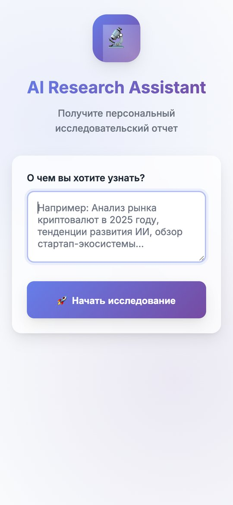
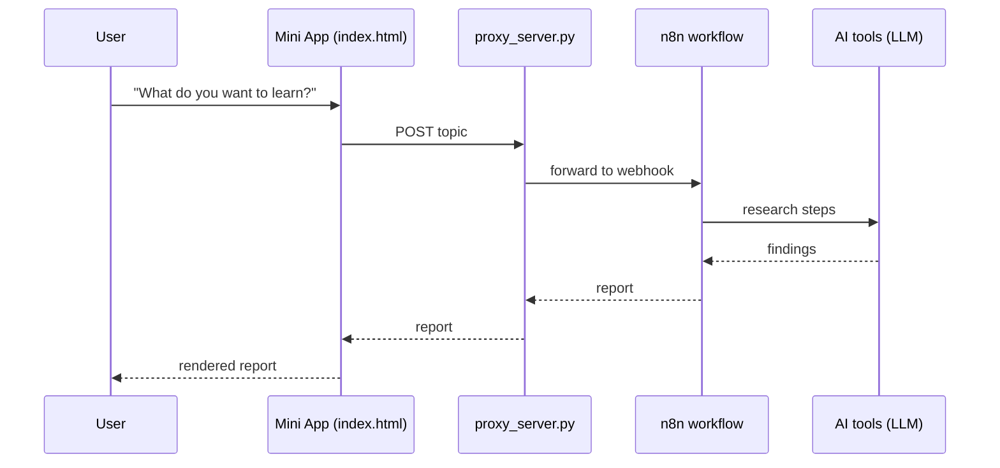

# ResearchMiniapp — AI research assistant for Telegram

A Telegram Mini App that produces a **personal research report** on any topic. The user describes what they want to learn — a market analysis, technology trends, a startup ecosystem overview — and an n8n AI workflow researches it and returns a report.

<p align="center"></p>

## How it works



## Files

```
index.html               — Mini App UI styled with Telegram theme variables
proxy_server.py          — Python proxy that forwards requests to the n8n webhook and handles CORS
server.py                — static dev server with CORS headers
Dockerfile, docker-compose-miniapp.yml, deploy.sh — deployment
```

## Run locally

```bash
python3 proxy_server.py     # set N8N_WEBHOOK_URL in the file to your n8n webhook first
python3 server.py           # http://localhost:8000
```

## Deploy

```bash
docker compose -f docker-compose-miniapp.yml up -d --build
```

See [`README-DEPLOY.md`](README-DEPLOY.md) for registering the Mini App with @BotFather.
